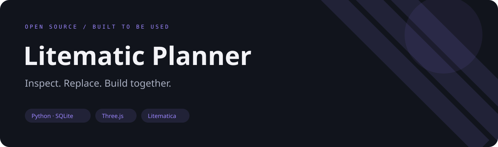
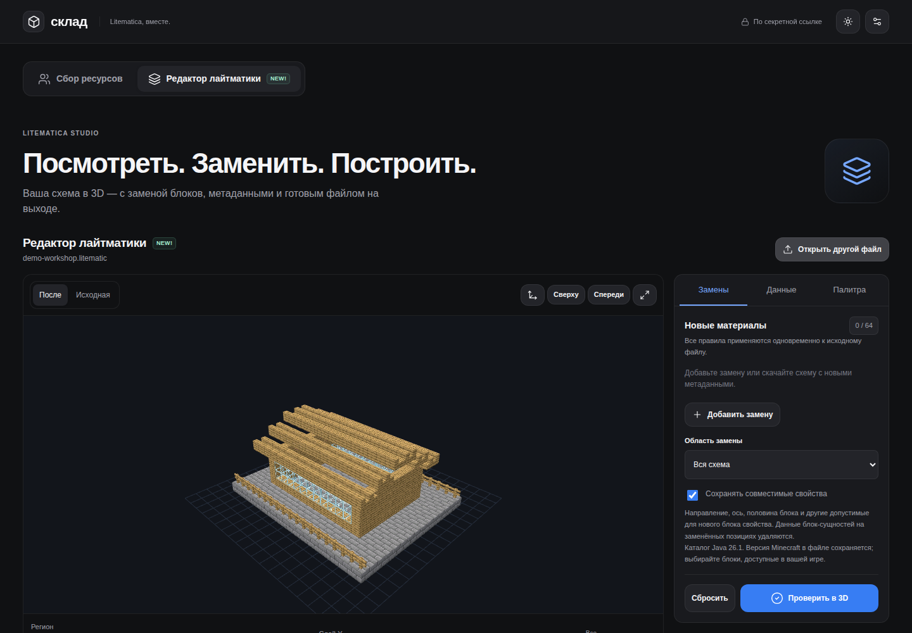
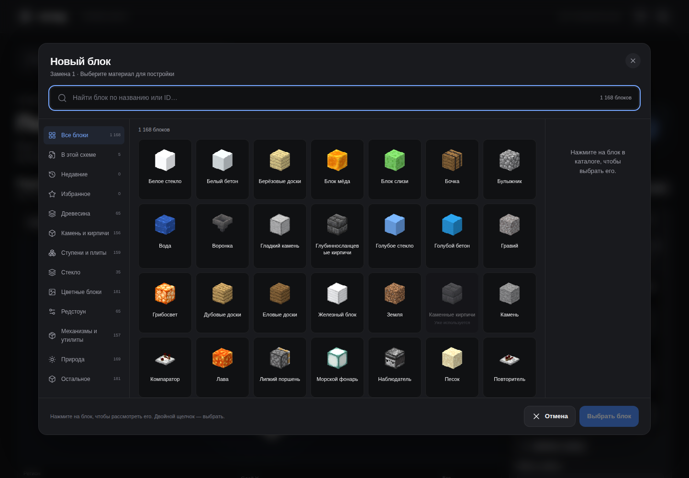

**English** · [Русский](README.ru.md)



# Litematic Planner

A self-hosted web workspace for editing `.litematic` schematics and coordinating the materials needed to build them.

[](https://github.com/ari3lYT/litematic-planner/actions/workflows/ci.yml)
[](LICENSE)

[Quick start](#quick-start) · [Architecture](docs/architecture.md) · [Development](docs/development.md)


## See it



<details>
<summary>Block catalogue</summary>



</details>

## What it does

- Inspect schematics in 3D with block models, rotations, multipart shapes and textures.
- Replace blocks globally or within one region, preserve compatible state properties, and download the edited schematic.
- Move a schematic between the editor and a shared material collection without losing the draft.
- Reserve materials, record deliveries, track contributors and organize warehouse chests.
- Keep collaboration state in SQLite; process editor uploads in memory.

## Quick start

Python 3.11+ and Node.js 22+ are recommended. Run from the repository root:

```bash
python3 -m venv .venv
. .venv/bin/activate
pip install -r requirements-dev.txt
npm --prefix frontend ci
npm --prefix frontend run build
python scripts/prepare_registry.py
python scripts/prepare_assets.py /path/to/your/minecraft-client.jar
python scripts/icon_server.py
```

Open `http://127.0.0.1:8875`, press **Build icons**, then stop that helper and run:

```bash
python app.py
```

Open `http://127.0.0.1:8874`. Minecraft artwork is generated from your own installed Java client;
it is not included in this repository. The locally generated block registry is attributed in [THIRD_PARTY.md](THIRD_PARTY.md).

## Configuration and contracts

See [configuration](docs/configuration.md) and the [HTTP API](docs/api.md). Collection links contain
access keys: treat them as private. The editor supports Litematica format versions 4–7, with a
40 MiB upload limit, a 96 MiB decompression limit and a 16 million cell budget. Large previews
are limited to 80,000 blocks; the downloadable schematic retains the complete edit.
Unsupported visual models are reported rather than silently represented as cubes.

## For developers

```bash
python -m unittest discover -s tests -v
npm --prefix frontend run build
```

See [development](docs/development.md) for model checks, fixtures and the source map.

[Release verification and limits](docs/verification.md) · [Changelog](CHANGELOG.md)
