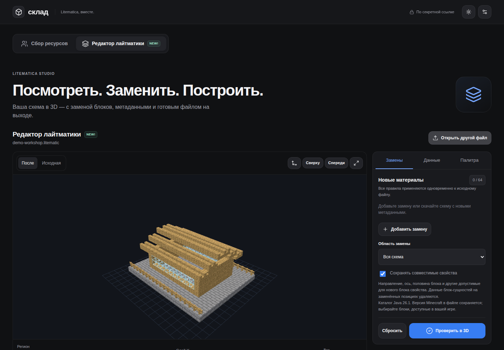
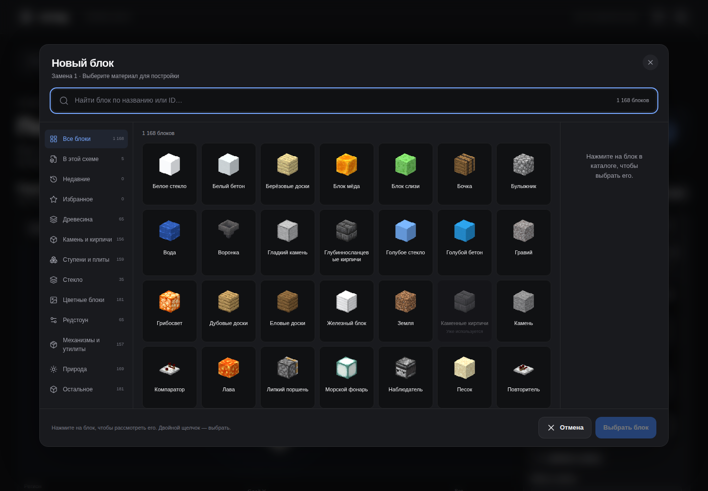

[English](README.md) · **Русский**


# Litematic Planner

Веб-приложение для собственного сервера: редактируйте схемы `.litematic` и вместе собирайте материалы для строительства.

[](https://github.com/ari3lYT/litematic-planner/actions/workflows/ci.yml)
[](LICENSE)

[Быстрый старт](#быстрый-старт) · [Архитектура](docs/architecture.ru.md) · [Разработка](docs/development.ru.md)

## Скриншоты



<details>
<summary>Каталог блоков</summary>



</details>

## Возможности

- Просмотр схем в 3D с моделями блоков, поворотами, составными формами и текстурами.
- Замена блоков во всей схеме или одном регионе с сохранением совместимых свойств состояния и скачиванием результата.
- Перенос схемы между редактором и общей коллекцией материалов без потери черновика.
- Резервирование материалов, учёт поставок и участников, организация складских сундуков.
- Хранение совместной работы в SQLite; обработка загруженных в редактор схем в памяти.

## Быстрый старт

Рекомендуются Python 3.11+ и Node.js 22+. Выполните из корня репозитория:

```bash
python3 -m venv .venv
. .venv/bin/activate
pip install -r requirements-dev.txt
npm --prefix frontend ci
npm --prefix frontend run build
python scripts/prepare_registry.py
python scripts/prepare_assets.py /path/to/your/minecraft-client.jar
python scripts/icon_server.py
```

Откройте `http://127.0.0.1:8875`, нажмите **Build icons**, затем остановите вспомогательный сервер и запустите приложение:

```bash
python app.py
```

Откройте `http://127.0.0.1:8874`. Графические ресурсы Minecraft генерируются из установленного у вас Java-клиента и не входят в репозиторий. Источник локально создаваемого реестра блоков указан в [описании сторонних материалов](THIRD_PARTY.ru.md).

## Настройка и ограничения

См. [настройку](docs/configuration.ru.md) и [HTTP API](docs/api.ru.md). Ссылки на коллекции содержат ключи доступа: храните их в тайне. Редактор поддерживает версии формата Litematica 4–7. Ограничения: 40 МиБ на загрузку, 96 МиБ после распаковки и 16 миллионов ячеек. В большом предпросмотре показывается до 80 000 блоков; скачиваемая схема сохраняет все изменения. Неподдерживаемые модели явно отмечаются в интерфейсе.

## Разработчикам

```bash
python -m unittest discover -s tests -v
npm --prefix frontend run build
```

Проверки моделей, тестовые данные и расположение исходников описаны в [руководстве разработчика](docs/development.ru.md).

[Проверки релиза и их границы](docs/verification.ru.md) · [История изменений](CHANGELOG.ru.md)
