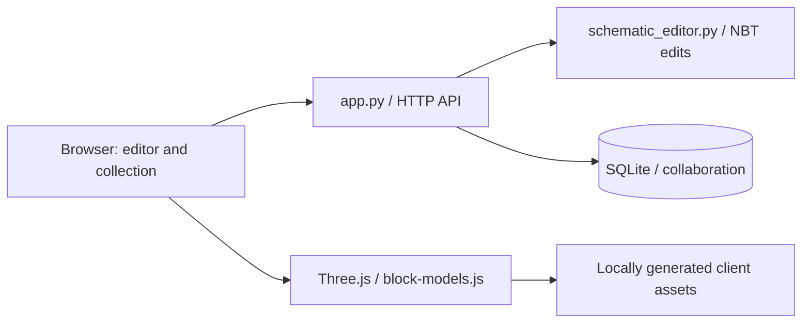

# Architecture

`schematic_editor.py` decodes packed palette indexes, applies simultaneous replacement rules,
preserves unknown NBT extensions and writes the original format. Negative region sizes are
normalized only for preview coordinates. The test suite independently reads output with Litemapy.

`app.py` owns HTTP routing, collection access, participant tokens, reservations, warehouse revisions
and undo records. SQLite uses WAL, foreign keys and a process-local reentrant lock. Editor work is
bounded by a semaphore with two slots. This is a single-process service; do not start multiple
workers against one database and assume the in-process locks coordinate them.

`frontend/block-models.js` resolves model inheritance, state variants, multipart rules, UV mapping
and tints. `schematic3d.js` instances the baked geometry. `scene3d.js` renders the warehouse.
Static UI scripts implement collection, chest and editor interactions.
