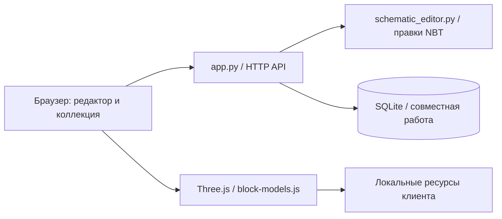

[English](architecture.md) · **Русский**

# Архитектура

`schematic_editor.py` декодирует упакованные индексы палитры, применяет правила замены одновременно, сохраняет неизвестные расширения NBT и записывает исходный формат. Отрицательные размеры регионов нормализуются только для координат предпросмотра. Тесты независимо читают результат через Litemapy.

`app.py` отвечает за HTTP-маршруты, доступ к коллекциям, токены участников, резервы, версии склада и записи отмены. SQLite использует WAL, внешние ключи и реентерабельную блокировку внутри процесса. Обработка схем ограничена семафором на два задания. Сервис рассчитан на один процесс; внутренние блокировки не координируют несколько процессов с общей базой.

`frontend/block-models.js` разрешает наследование моделей, варианты состояний, составные правила multipart, UV-развёртку и оттенки. `schematic3d.js` размещает экземпляры подготовленной геометрии; `scene3d.js` рисует склад. Статические скрипты интерфейса обрабатывают коллекции, сундуки и редактор.
